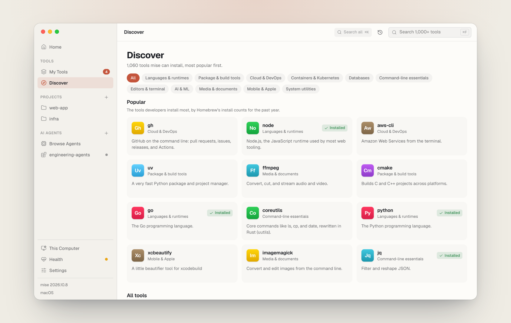

# powermise

An unofficial desktop companion for [mise](https://mise.jdx.dev): see every tool
mise manages, install the version you want, keep everything up to date, and check
your setup's health — from one window, on macOS, Windows, and Linux. Every action
shows the exact mise command it runs.

powermise isn't made by or affiliated with the mise project.

<picture>
  <source media="(prefers-color-scheme: dark)" srcset=".github/assets/powermise-dark.png">
  
</picture>

**[Website and docs](https://powermise.pages.dev)** ·
**[Live demo](https://powermise.pages.dev/#demo)** ·
**[Download](https://github.com/frankievalentine/powermise/releases/latest)**

## Install

```sh
# macOS and Linux
curl -fsSL https://powermise.pages.dev/install.sh | sh
```

```powershell
# Windows (PowerShell)
irm https://powermise.pages.dev/install.ps1 | iex
```

Or download an installer from the
[latest release](https://github.com/frankievalentine/powermise/releases/latest):
a universal `.dmg` for macOS, a setup `.exe` or `.msi` for Windows, and an
AppImage, `.deb`, or `.rpm` for Linux (x64 and ARM).

**Releases aren't code-signed yet**, so the first launch of a downloaded
installer takes one extra step (the install script skips it on macOS):

- **macOS** — click **Open Anyway** in **System Settings › Privacy & Security**,
  or run `xattr -dr com.apple.quarantine /Applications/powermise.app`.
- **Windows** — if SmartScreen appears, click **More info**, then **Run anyway**.
- **Linux** — `.deb` and `.rpm` install normally; an AppImage needs `chmod +x`
  and FUSE 2.

More in [Getting started](https://powermise.pages.dev/getting-started/#opening-it-the-first-time).

If you don't have mise yet, powermise installs it the first time it opens.

## What it does

- **My Tools and Updates** — every tool and version, where it's set, what's
  outdated (even past your pins), and what nothing uses anymore.
- **Discover** — the whole mise registry, most popular first, by category.
- **Projects** — each folder's tools, tasks (run from a form built from their
  arguments), and environment, with a trust review first.
- **Import** — bring over versions from nvm, pyenv, and other version managers,
  Homebrew and your Brewfile, winget and Scoop, and global packages, with a dry
  run before anything changes.
- **Health** — `mise doctor` in plain language, developer basics (Command Line
  Tools, build tools, Git for Windows), and shell setup for zsh, bash, fish,
  PowerShell, and Nushell.
- **This Computer** — `mise bootstrap`: system packages, dotfiles and their
  history, macOS settings, and newer versions of the tools macOS ships.
- **Harnesses** — install AI coding agents (Claude Code, Codex, ChatGPT, Amp, and more),
  their MCP servers, plugins, and skills, through mise.

The [app tour](https://powermise.pages.dev/app-tour/) walks through every screen.

## How it works

There's no powermise CLI — mise is the CLI. powermise reads mise's `--json`
output and changes things only by running mise's own commands, shown before they
run and streamed while they do. It never edits your own mise config; what it
writes goes in files of its own under `conf.d/` (an AI setup, an import, macOS
settings), which you can read, and delete to undo. See
[How powermise uses mise](https://powermise.pages.dev/how-it-works/).

## Development

You'll need [Bun](https://bun.sh) and [Rust](https://rustup.rs) — on macOS, also
Apple's Command Line Tools; on Linux, the
[Tauri system dependencies](https://tauri.app/start/prerequisites/).

```sh
bun install
bun run desktop:dev   # the desktop app, with hot reload
```

| Command | What it does |
| --- | --- |
| `bun run desktop:dev` | Runs the desktop app from source |
| `bun run desktop:ui` | Serves the app's UI alone in a browser at `localhost:1420`, with pretend data |
| `bun run desktop:build` | Builds the app and its installers |
| `bun run web:dev` | Runs the website and docs at `localhost:4321` |
| `bun run web:build` | Builds the website (and the demo it embeds) |
| `bun run web:deploy` | Builds and publishes the website to Cloudflare Pages |
| `bun run test` | Runs every Rust test |
| `bun run check` | Formatting, clippy, and type checks across the repo |
| `bun run fmt` | Formats the Rust code |
| `bun run release:version <x.y.z>` | Sets the version everywhere, ready to tag a release |

### Layout

| Path | What's there |
| --- | --- |
| `apps/desktop` | The Tauri v2 app: React UI in `src/`, Rust backend in `src-tauri/` |
| `apps/web` | The website and docs (Astro and Starlight) |
| `crates/powermise-mise` | Reads mise's JSON output and builds mise commands |
| `crates/powermise-setups` | Compiles AI setups into mise config, and the files powermise owns |
| `crates/powermise-domain`, `-registry`, `-compiler`, `-state` | The catalog's types, loading, compilation, and generated-file handling |
| `catalog/profiles` | The curated AI agents, tools, MCP servers, and plugins |
| `scripts` | Release, screenshot, and catalog helpers |
| `docs` | [The roadmap](docs/ROADMAP.md) and [the release process](docs/RELEASE.md) |

## License

[MIT](LICENSE)
