Every action in powermise opens a sheet that shows the mise command it will run.
Confirm it, and the sheet streams mise's output live; you can stop it at any
time. When it finishes, every screen refreshes from mise.

## Welcome

The first time powermise opens, Welcome fills the window and walks through five
steps, each checked off when it's already true:

1. **Install mise**, if it's missing — mise's install script (`curl
   https://mise.run | sh`) first on macOS and Linux, since that build updates
   itself without a password, or Homebrew; winget or Scoop on Windows. The
   sheet shows the exact command.
2. **Developer basics** — what git and anything that compiles need (see
   [Health](#health)), with a fix for whatever's missing.
3. **Turn mise on in your terminal** — the line to add to your shell's startup
   file: zsh, bash, fish, PowerShell, or Nushell. Command Prompt gets mise's
   shims on your Path instead; for any other shell, powermise links to mise's
   shell setup guide.
4. **Bring over versions you already have** opens [Import](#import), so mise uses them without
   downloading them again: nvm, nodenv, pyenv, uv, and Homebrew with
   `mise sync`; fnm, Volta, n, nvm for Windows, rbenv, RVM, chruby, goenv, and
   asdf (every tool it manages) with `mise link`, one version at a time.
   Versions mise already has are skipped. When that manager had a default —
   `nvm alias default`, `pyenv global`, asdf's `~/.tool-versions`, and so on —
   **Bring Over + Use** makes it your mise default too (`mise use -g`).
5. **Sign in GitHub downloads** (optional) — see [Health](#health).

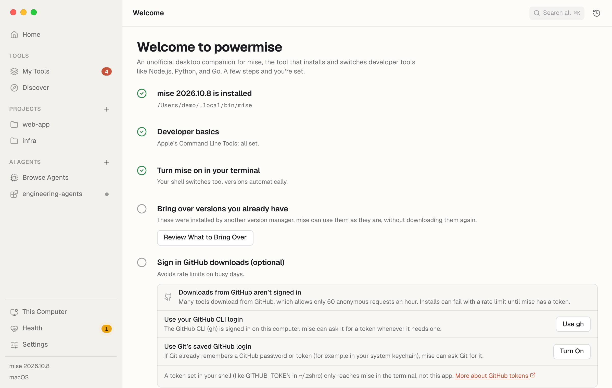

## Home

Where the app opens once Welcome is done. A **Get started** checklist ticks itself off as you go —
turn mise on in your terminal, install your first tool, add a project, bring over
versions from other managers, sign in GitHub downloads, set up AI agents — and
**At a glance** shows your tools and updates, health, projects, and AI setups,
with recent changes below. Press **⌘K** (Ctrl+K) anywhere to search pages, tools,
projects, setups, and settings at once.

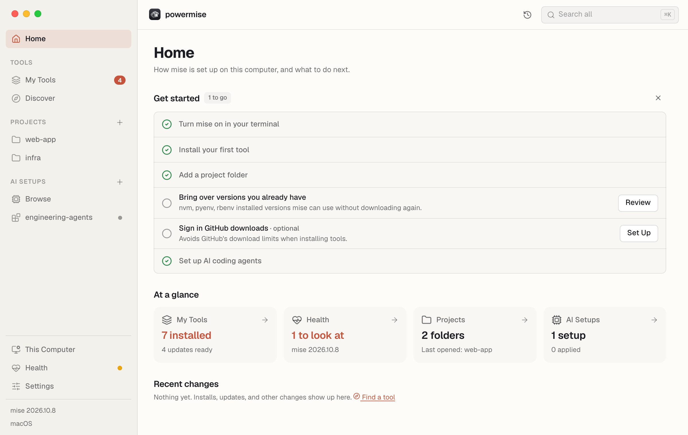

## My Tools

Every tool mise manages on this computer:

- **In use** — tools a config file asks for, with the active version and where
  it's set (**Global** means your `~/.config/mise/config.toml`).
- **Installed, not in use** — older versions nothing asks for anymore.

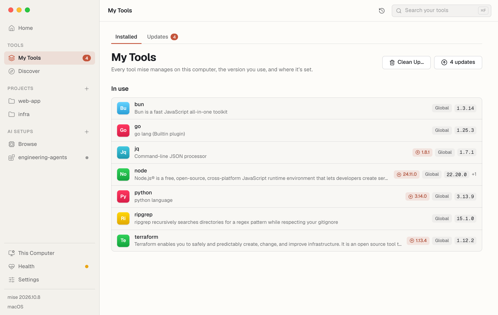

A blue badge means a newer version is available. Click a tool to open its page.

**Clean Up…** lists installed versions no config uses — not your global config,
a project, or an AI setup — with the disk space each takes, and deletes them.

Reads: `mise ls --json`, `mise outdated --bump --json`, `mise ls --prunable --json`
· Runs: `mise prune --tools --yes`

## Discover

Every tool in the [mise registry](https://mise.jdx.dev/registry.html), most
popular first — ranked by how often developers install each one (Homebrew's
public install counts for the past year). **Popular** shows the top tools, and
the category chips narrow the list: languages, package and build tools, cloud
and DevOps, containers and Kubernetes, databases, command-line essentials,
editors, AI, media, and mobile. Search matches names, aliases, and descriptions.

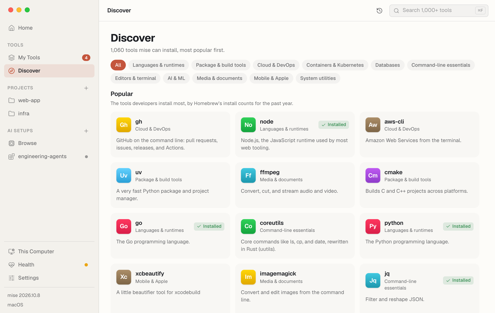

- **System utilities** (macOS and Linux) — everyday tools mise doesn't version,
  like wget, tree, htop, gnupg, and rsync, installed as system packages
  (`mise bootstrap packages use -g brew:wget`; apt on Linux, in your terminal so
  it can ask for your password).
- **Also available** — search finds popular tools from other ecosystems, like
  `pipx:httpie` or `gem:fastlane`.
- Anything else mise can install, search by full name — `npm:prettier`,
  `github:cli/cli`, `cargo:ripgrep` — and open it like any other tool.

Reads: `mise registry --json`, `mise backends ls`, `mise bootstrap status --json`

## Tool pages

- **Install / Change version** — pick a version (latest by default) and install
  it as your default everywhere. Projects can still ask for their own version.
- **On this computer** — each installed version and where it's used. Remove a
  tool from your global config, or uninstall a version that nothing uses.
- **Details** — where mise installs it from (the source it actually uses is
  highlighted), how it checks downloads (checksums, GitHub attestations, SLSA,
  signatures), tool options, aliases, the homepage, and release notes. On mise
  2026.10+, **Update automatically** lets mise upgrade that global tool in the
  background (`mise config set --global tools.<tool>.auto_update true`).

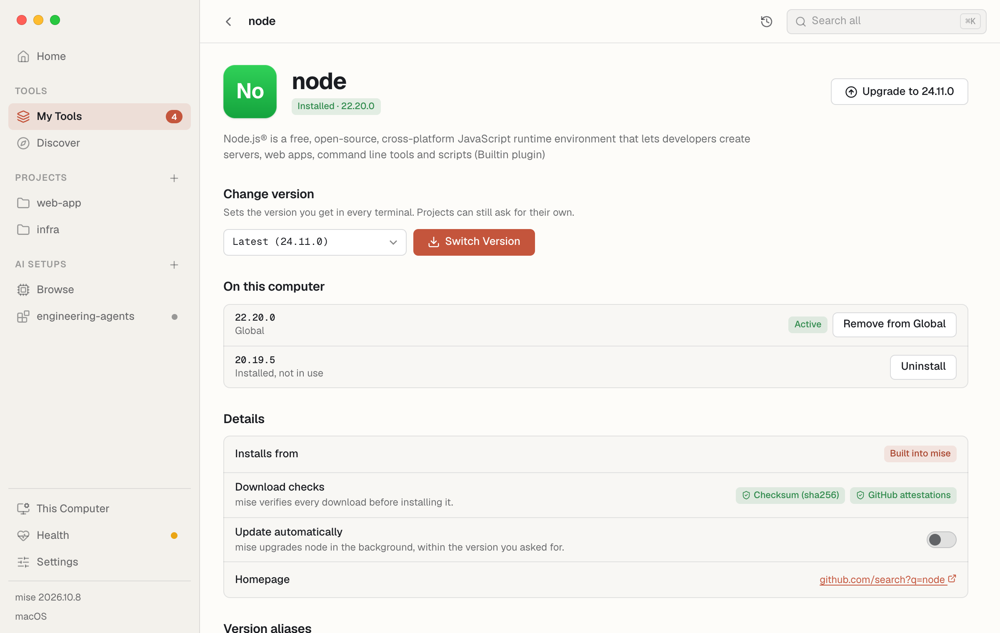

| Action | Command |
|---|---|
| Install or switch version | `mise use -g <tool>@<version>` |
| Upgrade | `mise upgrade --bump <tool>` |
| Remove from global | `mise unuse -g <tool>` |
| Uninstall one version | `mise uninstall <tool>@<version>` |

Reads: `mise ls-remote --json <tool>`, `mise tool --json <tool>`

**Version aliases** lists names you can use instead of a version (`node@lts`),
and adds your own to the global config (`mise tool-alias set node work 22`).

Each tool page also has **Link a Folder…**: point mise at an install made
outside it — built by hand or by another tool — and it uses that copy as a
version (`mise link`).

## Updates

The **Updates** tab of My Tools.

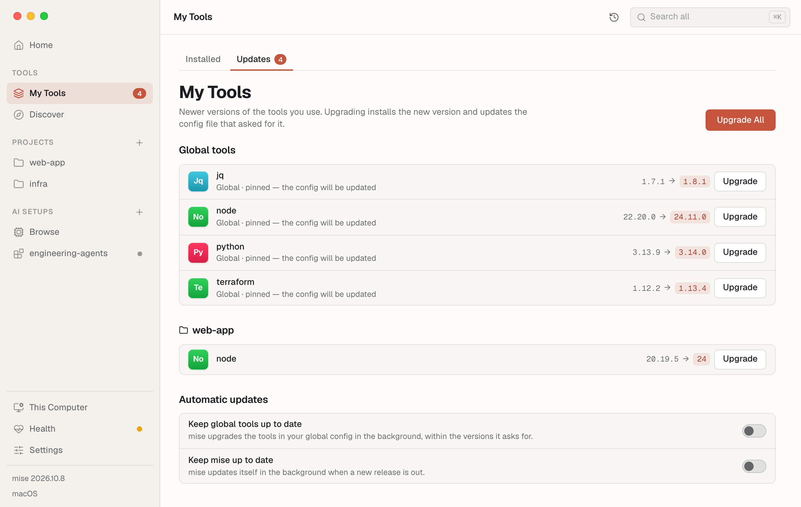

Everything with a newer version — including tools pinned to an exact version,
which a plain `mise outdated` leaves out. Upgrading a pinned tool moves the pin
in your config to the new version.

- **Global tools** — your global config. On mise 2026.10.7+ this uses
  `--global`, so a project config that lives in your home folder isn't mixed in.
- **Each project** you've added — what its own config asks for, upgraded in
  that project's config (`mise upgrade --local --bump`, run in the folder).
- **Automatic updates** (mise 2026.10+) — switches for upgrading global tools
  (`tool_update.global_auto`) and mise itself (`self_update.auto`) in the
  background.

Commands: `mise upgrade --global --bump [<tool>]` (or without `--global` on older
mise), `mise upgrade --local --bump [<tool>]` in a project.

## History

Open it with the clock button in the toolbar.

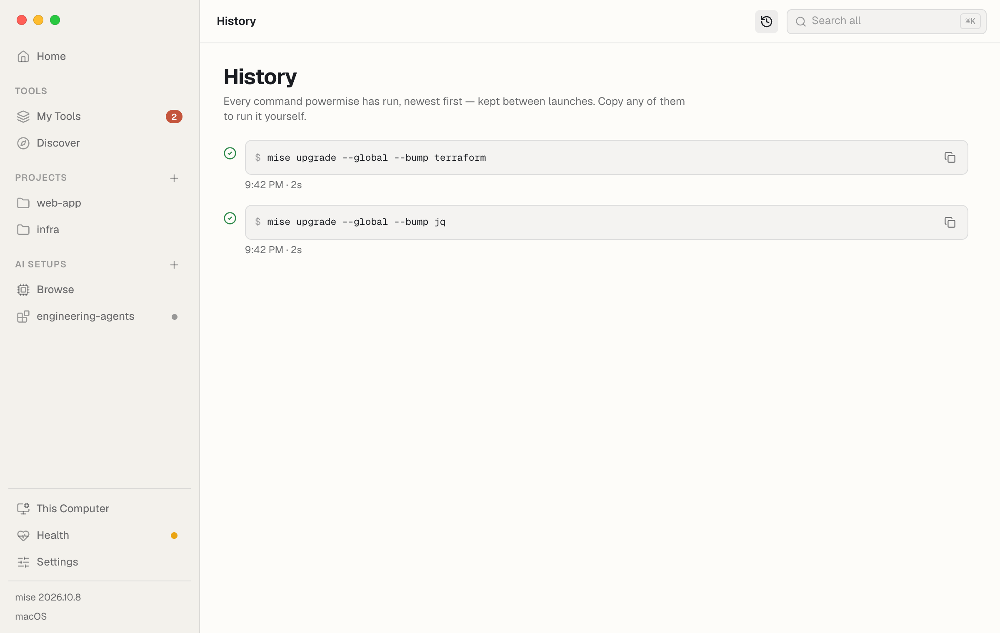

Every command powermise has run, kept between launches (the newest 500), with
how long it took and whether it worked. Copy any of them to run it yourself.

## Projects

Add a folder with **+** next to **Projects** in the sidebar (or drop it on the
window). powermise never scans your disk; it only shows folders you add.

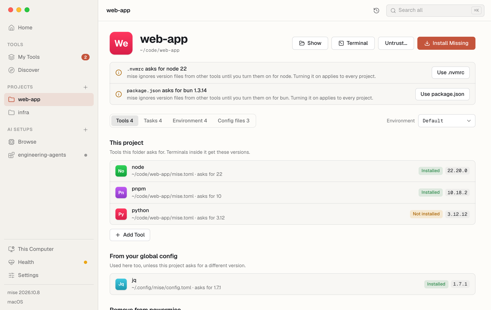

- **Terminal** opens your terminal app in the folder with the project's tools
  and environment ready (`mise en`).
- **Environment** (when the project has `mise.staging.toml` and similar) previews
  what mise loads with `MISE_ENV=staging` — tools, variables, and tasks.
- **Untrust…** revokes trust for a folder mise trusts by name (`mise untrust`).

### Trust comes first

mise won't load a project's config until you trust it, because a config can
set environment variables, load files, and run commands automatically. For an
untrusted folder, powermise reads the config files itself — without running
anything — and shows what trusting would allow. Hooks that run on their own and
files it would load are highlighted. **Trust Folder** runs `mise trust` only
after you confirm.

### Tools

What the project asks for, and what it inherits from your global config.
**Install Missing** runs `mise install` in the folder; **Add Tool** runs
`mise use <tool>@<version>` there, which adds it to the project's `mise.toml`.

Version files from other tools — `.nvmrc`, `.python-version`, `.ruby-version`,
`rust-toolchain.toml`, .NET's `global.json`, `.sdkmanrc`, `.zig-version`, and
the rest of the files mise's built-in tools read — are listed when mise isn't
reading them. **Use .nvmrc** turns them on
for that tool in every project (`mise settings add
idiomatic_version_file_enable_tools node`).

### Tasks

Every task the project defines. **Run** opens a form generated from the task's
arguments, flags, and choices, and shows the exact command as you fill it in:

```sh
cd ~/code/web-app && mise run deploy -- staging --dry-run
```

Arguments go after `--`, so one like `--force` always reaches the task.

- A task's dependencies are listed with it, and **What runs first** shows the
  whole tree.
- **Watch** reruns a task whenever its `sources` change (`mise watch <task>`),
  until you stop it. It needs watchexec; powermise offers to install it first.
- Interactive tasks open in your terminal app (**Run in Terminal**), since they
  need a real terminal to read input.

### Environment

The variables mise sets in the folder and the file each comes from. Values mise
marks `redact = true` — and names that look like secrets — stay hidden until you
reveal them. Add a variable to `mise.toml` (shared with the project) or
`mise.local.toml` (this machine only; the default for secret-looking names).
Values are never shown in the activity log: `mise set --file mise.local.toml API_TOKEN=•••`.

**Vars** (mise 2026.10.6+) lists the project's `[vars]`. Ones declared with a
`prompt`, `default`, or `required` can be saved on this computer
(`mise vars NAME=VALUE`) and forgotten again (`mise vars unset NAME`); values
written in the config are fixed. **Secrets** lists secret names and their source
when mise's experimental secrets support reports them — never their values.

### Config files

The files mise reads in the folder, most specific first — when two ask for the
same tool, the higher one wins. **Edit a Value…** sets one dotted key in a
project file (`mise config set --file mise.toml tools.node 22`), and **Format
Config Files…** tidies their layout (`mise fmt`).

- **Lockfile** — whether `mise.lock` matches the config (`mise lock --dry-run
  --json`), with **Update** or **Create Lockfile** (`mise lock`).
- **Add to this project** — a GitHub Actions workflow, a Git pre-commit hook, or
  a dev container, previewed before mise writes it (`mise generate … --write`).
  The workflow and hook need a Git repository.

## Import

**This Computer › Import…** (also from Home and Welcome) brings over what you
already have, in one list with a dry run before anything changes:

- **Version managers** — nvm, nodenv, pyenv, uv, and Homebrew (`mise sync`);
  fnm, Volta, n, nvm for Windows, rbenv, RVM, chruby, goenv, and asdf (`mise
  link`), with each manager's default as your mise default if you keep **Use
  …** checked.
- **Command-line packages** — `npm -g`, pipx, `uv tool`, `cargo install`,
  Ruby gems that install commands, and asdf-style default-package files (`~/.default-npm-packages`, `-python-`,
  `~/.default-gems`, which mise is retiring), as mise tools.
- **Homebrew** — formulas you installed yourself, casks, and every Brewfile
  (`~/Brewfile`, `~/.Brewfile`, `~/.config/homebrew/Brewfile`, or **Add a
  Brewfile…**). Formulas mise has as its own tools become mise tools; the rest
  become `brew:` and `brew-cask:` packages, tap-qualified where needed.
- **Mac App Store** — apps from `mas list` and your Brewfile's `mas` lines.
- **winget and Scoop** (Windows) — what `winget export` lists and Scoop's
  installed apps, or a `winget export` / `scoop export` file from another PC
  (**Add an Export File…**). Tools mise has itself become mise tools; the rest
  become `winget:` and `scoop:` packages.
- **Chocolatey** (Windows) — installed packages or a `packages.config`. mise
  can't install Chocolatey packages, so only the ones mise has as its own
  tools come over; the rest are listed so you know to keep them.
- **Installed another way** — install scripts, `go install`, Snap, and so on.

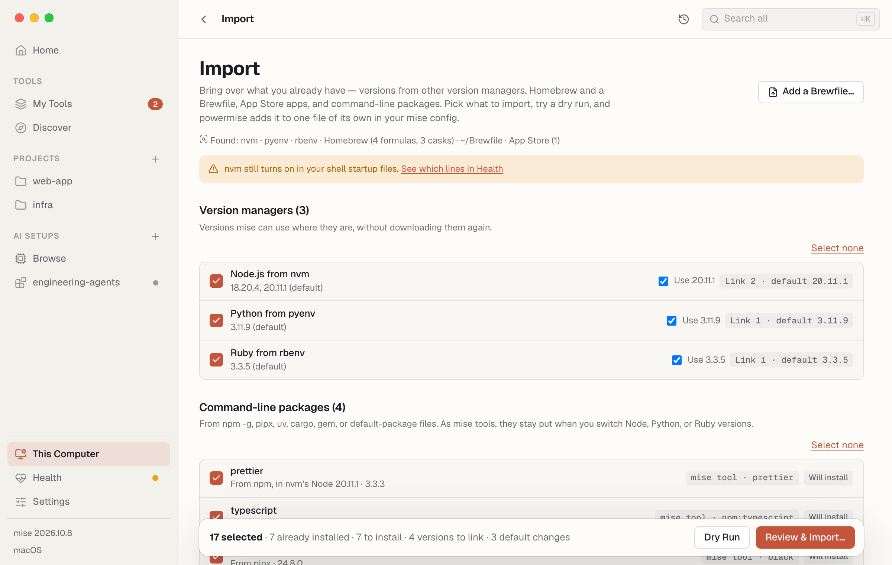

Brewfile and export-file entries are checked to start; things only found
installed aren't.
Each row says what it becomes in mise and whether it's already installed.
**Dry Run** runs `mise install --dry-run` and `mise bootstrap packages apply
--dry-run` for your picks. **Review & Import** shows the file powermise writes —
`conf.d/powermise-imported.toml`, its own, which it adds to on later imports and
which you can delete to undo — then links versions, sets defaults, and installs
only what isn't here yet. Imported `brew:` formulas also get their folders on
your PATH (`[env] _.path`, for example `/opt/homebrew/opt/jq/bin`), since mise
installs formulas without adding them. What Homebrew already installed stays
Homebrew's; on your next Mac, `mise bootstrap` installs it all without
Homebrew (and on Windows, through winget and Scoop).

## Health

Health leads with **Needs attention** — only what's wrong, each with its fix —
and keeps the rest under **More details**:

- **mise** — your version, the minimum powermise needs, and an update button
  when a newer mise is out (`mise self-update`).
- **Developer basics** — mise's Node, Python, Ruby, and Go come ready-built,
  but git, and anything that compiles (gems and npm packages with native code,
  `cargo install`), needs more:
  - **macOS:** Apple's Command Line Tools. **Install…** opens Apple's own
    installer (`xcode-select --install`).
  - **Linux:** a C compiler, make, git, and curl. **Install in Terminal…** runs
    `mise bootstrap packages apply --update` with your distribution's packages
    (`apt:build-essential`, `dnf:gcc`, `pacman:base-devel`, …) in your
    terminal, where `sudo` can ask for your password.
  - **Windows:** Git for Windows (`winget:Git.Git` through mise), and
    PowerShell's script policy. Windows ships with `Restricted`, which skips
    `$PROFILE` — and the line that turns mise on with it. **Allow Profile
    Scripts** sets `RemoteSigned` for your account
    (`Set-ExecutionPolicy -Scope CurrentUser RemoteSigned`). When your
    organization sets the policy, Health says so instead.
- **Your shell** — whether mise is activated. If it isn't, powermise shows the
  line to add to your shell's startup file. It won't edit that file for you.
- **Problems mise found** and the **config files** it reads.
- **GitHub downloads** — whether mise has a GitHub token (masked), and two ways
  to give it one you already have: your GitHub CLI login
  (`github.credential_command = "gh auth token"`) or Git's saved login
  (`github.use_git_credentials`).
- **Other version managers still turned on** — a line in `.zshrc`, `.bashrc`,
  `.profile`, fish's `config.fish`, a PowerShell profile, or Nushell's `env.nu`
  or `config.nu` that starts nvm, pyenv, rbenv, asdf, fnm, Volta, or another
  manager, which fights mise over `PATH`. Health shows the file and line
  to remove once your versions are brought over; it won't edit the file for you.
- **Bring over what you already have** — a link to [Import](#import) when it
  finds something.
- **Shims** — when mise's shims are on your PATH, what they're for and
  **Rebuild Shims** (`mise reshim`).
- **Plugins** — legacy asdf and vfox plugins, when any are installed. A plugin
  named like one of mise's built-in tools (node, python, go, …) replaces mise's
  own installer for it; Health flags it, and **Use Built-In** adds
  `[tool_alias] <tool> = "core:<tool>"` to your global config so mise's
  installer is used again. The plugin stays installed.
- **Trusted folders** — every folder or file mise trusts, with **Revoke**
  (`mise untrust`), and configs it was told to ignore.
- **Disk space** — installed tools and the download cache, with **Remove Old**
  (`mise cache prune`) and **Clear All** (`mise cache clear`), plus unused
  versions and **Clean Up…**.

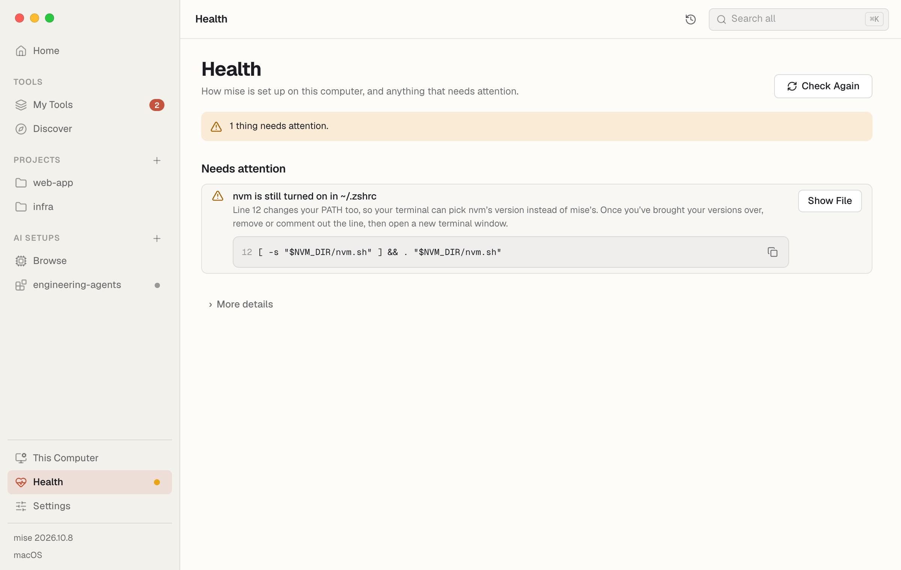

A dot next to **Health** in the sidebar means something needs attention:
amber for warnings, red when something is broken.

Reads: `mise doctor --json`, `mise version --json`, `mise token github`

## This Computer

What your global mise config sets up on this computer beyond tools — system
packages, dotfiles, Git repositories, services, macOS settings, and more — from
its `[bootstrap]` and `[dotfiles]` sections, with the state of each item.

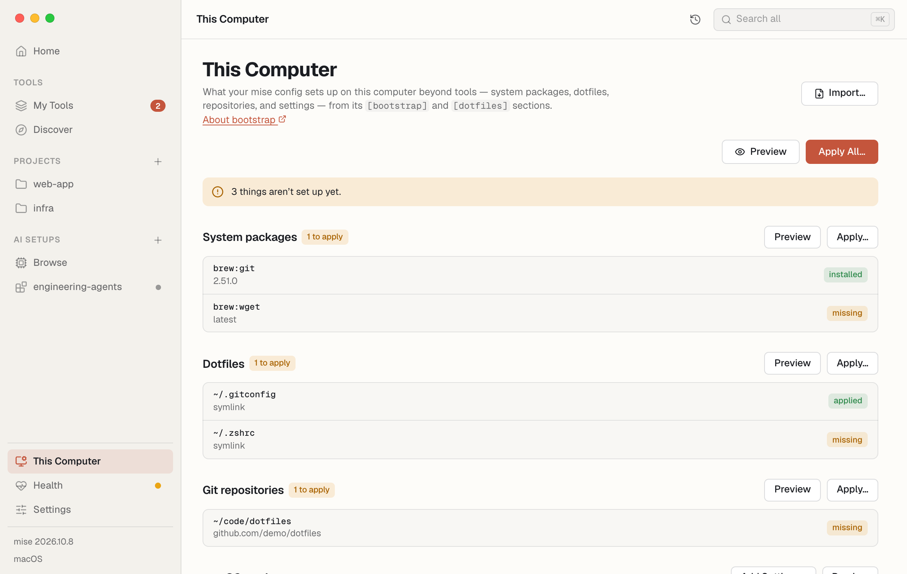

- **Preview** shows what applying would change, without changing anything
  (`mise bootstrap --dry-run`); **Apply** sets it up (`mise bootstrap --yes`).
  Both work for everything or for one part (`--only dotfiles`, for example).
- **Dotfile history** (mise 2026.10+) — checkpoints of the files mise tracks,
  **Save Checkpoint** (`mise dotfiles save`), and syncing with a Git repository
  (`mise dotfiles origin set <url>`, then `mise dotfiles sync`). Recent
  checkpoints can be previewed and rolled back to (`mise dotfiles rollback --to
  <id> --all`); mise records the state before a rollback, so **Undo Latest**
  (`mise dotfiles undo`) reverses it. **Resolve Conflicts** opens
  `mise dotfiles conflicts` in your terminal app.

Steps that need an administrator password (like apt packages) are best run from
a terminal: `mise bootstrap --yes`.

### macOS Settings

On a Mac, **macOS Settings** offers the settings catalogued at
[macos-defaults.com](https://macos-defaults.com) — Dock, Finder, Desktop,
keyboard, trackpad, mouse, Mission Control, menu bar clock, screenshots, and
apps like Safari, TextEdit, and Activity Monitor — each with its current value
and the documented choices (or a custom value). Your choices go into one file,
`~/.config/mise/conf.d/powermise-macos.toml`:

```toml
[bootstrap.macos.defaults."com.apple.dock"]
autohide = true
tilesize = 36
```

**Apply** runs `mise bootstrap --yes --only macos-defaults`, which writes them
with `defaults write`. Apps like the Dock and Finder show a change only after
they relaunch; **Relaunch** runs `killall Dock` (or the app named). Choosing
**Leave as is** stops managing a setting — its value stays. Needs mise 2026.10.

Reads: `mise bootstrap status --json`, `mise dotfiles status --json`

### Newer system tools

macOS ships old versions of some tools and never updates them: git (Apple's
build), bash 3.2 from 2007, make 3.81, curl, and Ruby 2.6. On an Apple Silicon
Mac, **Newer system tools** shows the version you have next to the current one.
**Use Newer** (or **Use All Newer**) shows the file powermise writes before it
writes it, `~/.config/mise/conf.d/powermise-system.toml`:

```toml
[bootstrap.packages]
"brew:curl" = "latest"
"brew:git" = "latest"

[env]
_.path = ["/opt/homebrew/opt/curl/bin", "/opt/homebrew/opt/git/bin"]
```

mise installs the Homebrew packages itself (`mise bootstrap packages apply`) —
Homebrew doesn't have to be installed — and `_.path` puts each one's own folder
ahead of macOS's in every terminal where mise is turned on, with no edits to
`.zshrc`. mise doesn't put Homebrew formulas on your PATH on its own, and the
`opt` folder works for curl too, which is keg-only (Homebrew never links it
into `/opt/homebrew/bin`). It isn't all of `/opt/homebrew/bin`: `_.path` goes
ahead of your mise tools, and that folder also holds Homebrew's copies of the
formulas' dependencies — its `python3` or `node` — which would shadow them.
Files written by an older powermise that list `/opt/homebrew/bin` lose it the
next time powermise rewrites them. Ruby comes
over as a mise tool instead (`mise use -g ruby@latest`). macOS's own copies
stay where they are; delete the file to go back to them. Apps opened from the
Dock or Finder don't read your shell, so they keep seeing macOS's versions.

## Settings

One page. The settings most people need come first, in plain words and grouped by
what they're for — installing tools, updates, projects, languages — each with
the control that fits: a switch, a number, a choice, or a list you pick from
(tools you have installed, or folders from the folder picker). Each says whether
it's at mise's default, changed by you, or set by a project or AI setup, with
**Reset**. Changes save right away; the row shows the exact command
(`mise settings set auto_install false`) with **Undo**, and every change is in
Activity. Search finds everyday words too: "nvmrc", "offline", "update".

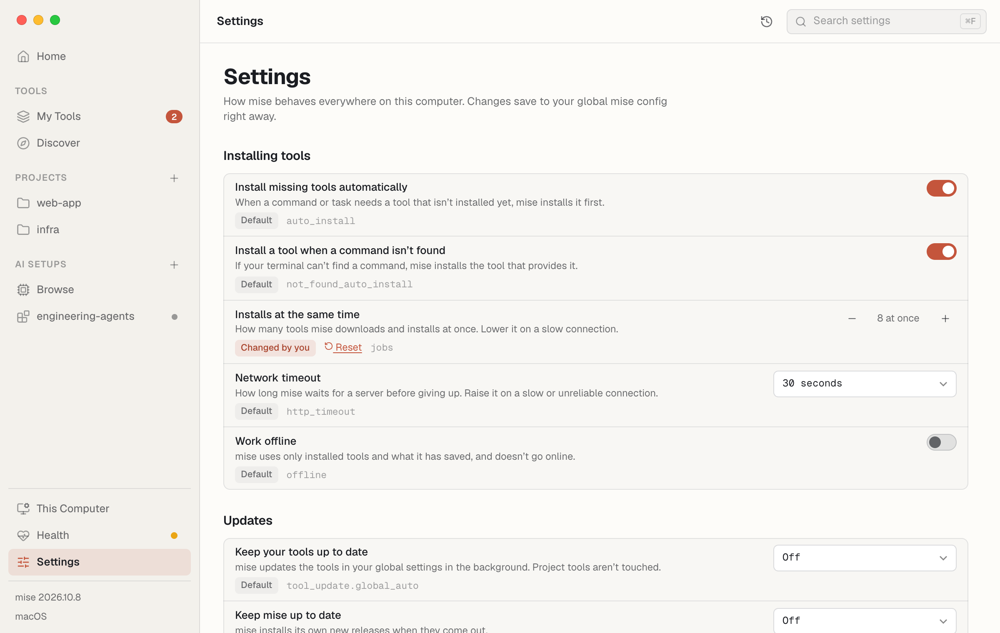

**Advanced settings**, folded away below, lists everything else by mise's own
setting name — never the ones above again — grouped as mise groups them, with
**Changed** to show only what you've set. Changes there show the command and ask
first. A search that only matches an advanced setting opens it.

Reads: `mise settings ls --all --json-extended`

## AI Setups

The **AI Setups** section of the sidebar. Harnesses are the apps and CLIs that
run AI coding agents (Claude Code, Codex, Cursor…). Browse them, then build a
setup that installs everything they need. See [AI Setups](/ai-setups/).

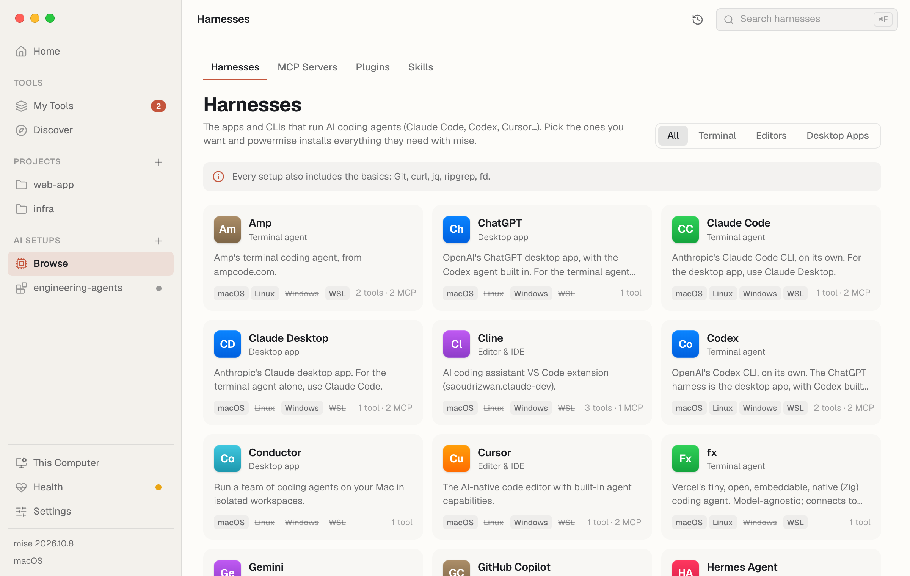

**MCP Servers** turns servers on agent by agent, including official ones from
companies like GitHub, Linear, Notion, and Stripe, adds your own, and shows
what each agent's settings list right now. See [MCP servers](/ai-setups/#mcp-servers).

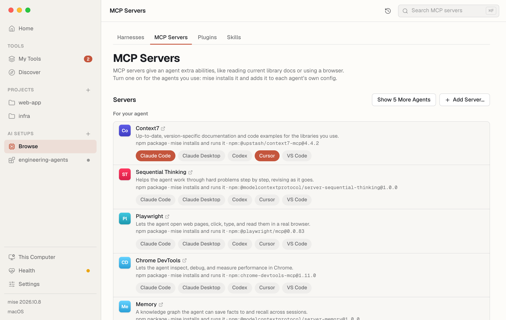

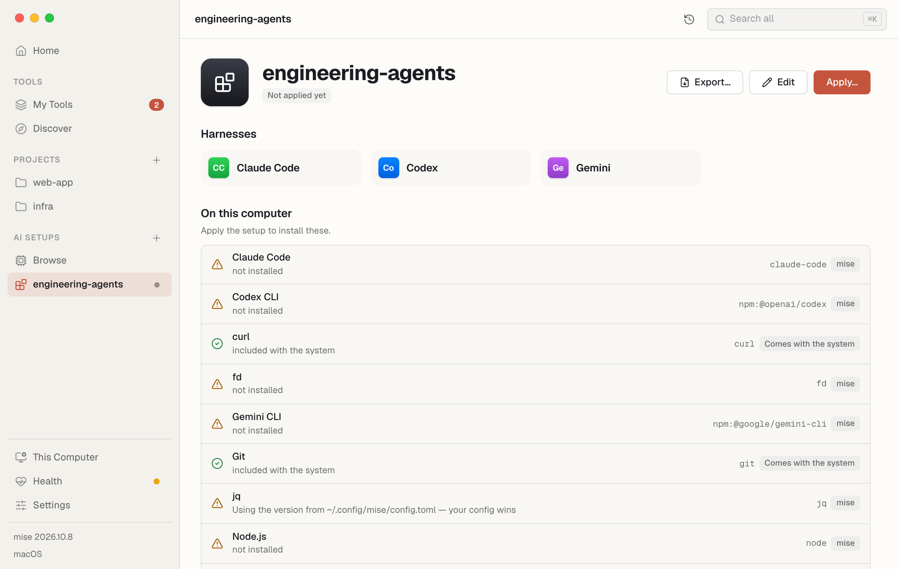
